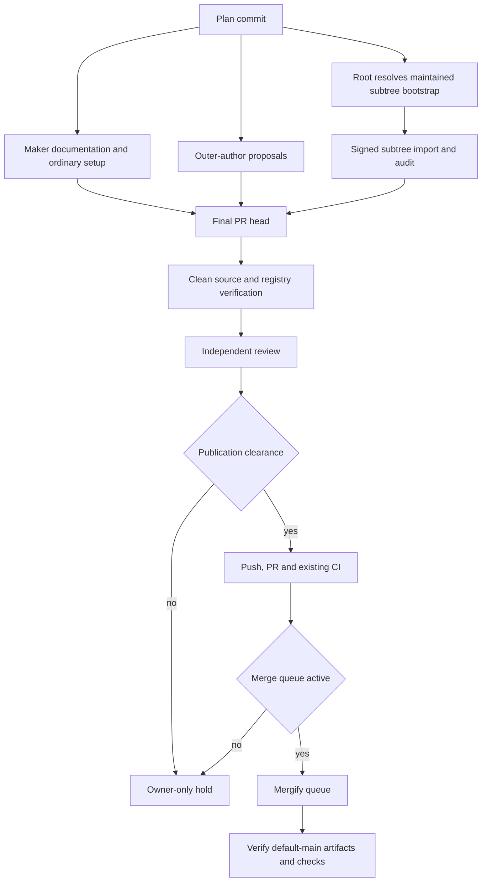

# README and Repository Setup - Plan

## Goal Capsule

**Objective:** A visitor can evaluate and use effect-memfs from accurate documentation, and contributors can set up the extracted repository without inheriting incorrect attribution.

**Means:** Separate registry and source evidence, restore ordinary repository setup, and complete the authorized review and merge path (KTD1–KTD4).

**Authority and stop conditions:** SYS-1166 and the current operator instructions govern scope. The maker never edits locked agent instructions or judgment surfaces. Stop at an unavailable authorized author, an unresolved subtree bootstrap conflict, unverified publication clearance, missing required evidence, or a non-activated merge queue. The plan commit precedes every implementation commit. No push is authorized by this planning assignment.

---

## Product Contract

### Summary

Produce a repository-specific root README and contributor setup, a tracked constitution subtree, a matching Apache license, and accurate attribution. Verify the actual PR head and default branch rather than treating draft text as evidence.

### Problem Frame

The extracted public repository has no root README or ordinary root setup files. Existing descriptions say it is a fork, contrary to the SYS-1166 ruling. The package version in source is ahead of the registry's latest version, so a source-derived example cannot be assumed to describe the registry artifact.

### Requirements

**Reader and contributor experience**

- R1. Create a real root README through the maintained `write-readme-md` procedure, with process, checks and numerical score reported on the PR.
- R2. Verify each install and use claim in a fresh checkout of the actual final PR head, recording the exact SHA, environment, commands, outputs, and exit statuses.
- R3. Distinguish source-checkout use from a separately executed registry-consumer example; do not represent source version 6.0.4 as published or publish any package.
- R4. Add repo-specific `CONTRIBUTING.md`, ordinary applicable Claude settings, a root constitution pointer, a declarative constitution subtree, and the template-matching root Apache-2.0 license.

**Attribution and authority**

- R5. Correct only false repository-fork descriptions at the five named destinations; re-inspect all fork matches and preserve unrelated uses.
- R6. Never author or edit locked `AGENTS.md` or `CLAUDE.md`; supply complete proposed text and exact destinations unapplied to the authorized outer source route under `agent-docs`.
- R7. Route any Gemini copy request through root's existing approved browser actor, one question per operation; treat output as a lead and verify every claim against sources.

**Delivery**

- R8. Use report-only `ce-doc-review`, independent code review, original findings and dispositions, existing required CI and Mergify; verify artifacts on default main after merge.
- R9. Before any future push, verify current SYS-1111 publication clearance, not just issue status. If Merge Queue is not activated, record an owner-only hold; never manually merge or bypass policy.
- R10. Add no tests, checks, gates, provider, paid service, publication bypass, visibility change, starter product content, or worktrunk-scripts subtree.

### Scope Boundaries

- Implementation, README copy, setup, license and attribution changes are not authorized by this planning run.
- Existing package behavior, real `Effect.forkScoped` and the Vite split-forks comment are outside attribution cleanup.
- No new automation or compatibility shim is warranted; the existing tooling and review routes are the requested mechanisms.

### Sources

- [SYS-1166](https://linear.app/systemfsoftware/issue/SYS-1166/effect-memfs-deliver-readme-and-extracted-repo-setup-remove-false-fork), parent SYS-1135, and [SYS-1111](https://linear.app/systemfsoftware/issue/SYS-1111/omp-profile-op28-no-local-full-gates-contradicts-ce-commit-push-prs).
- Base `fcfd0127cfb53fcd2c766c25805d3043a5e9285f`: `package.json`, `packages/effect-memfs/package.json`, `packages/effect-memfs/src/mod.ts`, `packages/effect-memfs/src/MemoryFileSystem/mod.ts`, `packages/effect-memfs/src/memory-file-system.blueprint.ts`, and `packages/effect-memfs/tests/clean-up-temporary-files.integration.test.ts`.
- [npm latest metadata](https://registry.npmjs.org/@systemfsoftware%2feffect-memfs/latest) reported 6.0.0 on 2026-11-06; the [6.0.4 registry endpoint](https://registry.npmjs.org/@systemfsoftware%2feffect-memfs/6.0.4) returned HTTP 404. Source version 6.0.4 was unpublished at that check. Recheck at execution; the package exports `dist/mod`, and root specifies pnpm 12.9.0.
- Pinned [starter tree](https://github.com/systemfsoftware/effect-endgame-starter-kit/tree/80f85e8f3caab86ee2cf8159592da401cba7b28f): `CLAUDE.md`, `subtrees.toml`, `.claude/settings.json`, `CONTRIBUTING.md`, `CONSTITUTION.md`, `LICENSE`. The named local reference checkout was unavailable; these were read from pinned GitHub Git objects/content, not a working tree. Its `CONSTITUTION.md` is the full constitution, not a pointer; the requested pointer is a deliberate divergence. Starter and package license bytes share SHA-256 `ba24c1fd402c3031ea9e849cf9a9ad300ddf30dce9a81d1894a7e7141dbad339`.
- `.compound-engineering/config.yaml` and `config.local.yaml` are absent at the base; the pack resolver returned no roots, warnings or errors. Do not add configuration.

---

## Planning Contract

### Key Technical Decisions

- KTD1. **Separate artifacts by audience and version.** The root maps the workspace and shows a verified useful call; the leaf remains the package's registry-facing page. Source setup and contributor commands belong in `CONTRIBUTING.md`. A root example must either run against the registry artifact it names or explicitly be a source-checkout example. This avoids treating different release states as interchangeable.
- KTD2. **Use the maintained subtree mechanism, not a hand-written copy.** Track upstream `main` and compare its fetched tree with the resulting `HEAD:repos/constitution`; a named vendor ref, signed synthetic squash/merge and audit establish real subtree provenance. Counter-case: copying the directory is simpler but loses update provenance; direct `git subtree add` risks the `FETCH_HEAD` race described by G28.
- KTD3. **Root owns a maintained-source bootstrap repair before import.** `git-subtree-vendor/references/initial-setup.md:37-41` says to commit a populated first config before the add script. `scripts/add-subtree.ts:94-103` requires an existing config but refuses the already-registered name, and its import then separate registration commit at lines 169–180 conflicts with G11's config-and-subtree-together rule. Initial-setup Approach B invokes `git subtree add`, forbidden by G28; the schema also requires at least one entry. None of these sequences is valid. Root must obtain a source-supported route or arrange an authorized repair of the maintained first-subtree procedure and script that makes initialization, registration, G11 and G28 consistent, preserving signed tree import and audit. The maker must not edit the installed machinery, introduce unrelated vendors, bypass guards, or pretend an empty config is valid. This blocks U2, not U1 or drafting.
- KTD4. **Locked outer author owns agent files.** The maker supplies a full replacement for `AGENTS.md`, preserving every existing instruction except the unsupported fork phrase, and a complete proposed `CLAUDE.md` containing only the three reference imports. The authorized outer author applies them. The maker verifies the resulting committed bytes without writing those destinations.
- KTD5. **Treat the scorer as a measurement, not a quality gate.** `write-readme-md/SKILL.md` requires shape selection, clean consumer execution, prose humanization, the 13-criterion scorer and manual checks. Its holdout means are 4.69/13 trending and 3.74/13 matched control; no score proves quality and no threshold is added. Read `references/readme-library.md`, `references/readme-monorepo.md`, `references/structure.md`, `references/readme-root-design.md`, and `references/readme-prose-humanizer.md` within that skill before drafting.

### High-Level Technical Design

### Assumptions and Deferred Evidence

- Whether the published 6.0.0 surface supports the chosen source example is unverified; execute both paths separately and document only the behavior each proves.
- Exact execution-time upstream constitution commit, final PR SHA, queue activation, current clearance, supported subtree bootstrap and paid-account billing are not known. Record real evidence; no invented receipts.
- Pinned starter settings call `comment-checker` and run `pnpm format` on stop. Adopt only applicable ordinary settings after checking availability and effects; do not introduce a new gate or copy app-specific bootstrap instructions.

### Cost

No new paid component or API call is planned: incremental expected and worst-case monthly cost of newly introduced paid services is **$0** at the expected load of one documentation/setup PR and its existing checks. Public standard GitHub-hosted runner compute is free; larger runners and excess artifact/cache storage can be billed, so total existing CI spend cannot be bounded without the account, workflow usage and retention data ([GitHub Actions billing](https://docs.github.com/en/billing/concepts/product-billing/github-actions)). npm lists public packages at $0 ([npm pricing](https://www.npmjs.com/products)); no publishing occurs here. The approved browser actor is existing, not a new API/provider purchase; its already-paid subscription and cost are unknown and must not be guessed. The plan does not establish existing account spend.

---

## Implementation Units

### U1. Establish evidence and prepare authorized proposals

**Goal:** Establish correct source facts and separate writer authority. **Requirements:** R5–R7, R9. **Dependencies:** plan commit. **Files:** `AGENTS.md` and `CLAUDE.md` (outer author only); `flake.nix`, `package.json`, `packages/effect-memfs/README.md`, `packages/effect-memfs/package.json` (maker). **Approach:** Reinspect every case-insensitive fork match, including `packages/effect-memfs/tests/watch-a-folder-for-changes.integration.test.ts` and `pnpm-workspace.yaml`; change only false attribution. Submit a complete proposed `AGENTS.md` preserving all other text and propose `CLAUDE.md` as exactly `@AGENTS.md`, `@subtrees.toml`, `@CONSTITUTION.md` on separate lines. Cite `agent-docs` ADOC-A1–A4 and ADOC-A14: grounded claims, separate reviewer, no new gate. Never edit either locked destination. **Test expectation:** none; metadata and instructions only. **Verification:** independently compare resulting outer-author files with proposals and confirm genuine fork matches remain. Reassess packed-output version policy in `AGENTS.md`; no package publish.

### U2. Add ordinary repository setup and subtree

**Goal:** Give contributors a truthful setup and a real tracked constitution. **Requirements:** R4, R6, R10. **Dependencies:** U1 and KTD3 resolution. **Files:** `CONSTITUTION.md`, `subtrees.toml`, `repos/constitution/`, `.claude/settings.json`, `CONTRIBUTING.md`, `LICENSE`. **Approach:** Use the maintained `git-subtree-vendor` initial setup, G11, G24, G28, G30 and G31 after its owner resolves KTD3. Pin the actual fetched `main` SHA in evidence, use no tag auto-follow, validate TOML and compare actual subtree tree to vendor ref; check signing and dangling gitlinks. Keep vendored content read-only. Make the root pointer refer to the vendored constitution; do not copy the starter's full root file. Copy the byte-identical package license to the root. Derive contributor setup from `flake.nix`, `pnpm-workspace.yaml` and the existing root setup, not the starter's app-specific sandbox or `pnpm bootstrap`. **Test expectation:** none; use configuration, tree and clean-checkout evidence. **Verification:** config validates, subtree audit matches fetched tree, root license matches template bytes, and contributor setup executes on the final head.

### U3. Write and verify the README

**Goal:** Give users a trustworthy route to a useful result. **Requirements:** R1–R3, R7. **Dependencies:** U1 and U2. **Files:** `README.md`, `CONTRIBUTING.md`; source references `packages/effect-memfs/src/MemoryFileSystem/mod.ts`, `packages/effect-memfs/src/memory-file-system.blueprint.ts`, `packages/effect-memfs/src/MemoryFileSystemSpec.schema.ts`, `packages/effect-memfs/tests/clean-up-temporary-files.integration.test.ts`. **Approach:** Follow KTD1 and KTD5, using root map plus one minimal genuine usage path, not copied starter prose. The current source exports `MemoryFileSystem` from the package root; its blueprint `make` supplies a layer containing `FileSystem` and `Watcher`. Derive the runnable example from source and tests, and verify exact API and output on each artifact used. Ask root's existing browser actor for copy using the prompt below, then independently check every claim. **Execution note:** smoke the copyable consumer path rather than introducing permanent tests. **Test expectation:** none; documentation only. **Verification:** clean final-head checkout and separate registry consumer each record commands, actual output, exit status, OS, runtime/tool versions, SHA and timestamp; every README install/use claim has matching evidence. Record score out of 13 and individual criterion report on the PR, plus link, version, theme and README routing checks.

### U4. Review, publish only when cleared, and verify main

**Goal:** Preserve independent review and the existing merge policy. **Requirements:** R8–R10. **Dependencies:** U1–U3. **Files:** `.github/workflows/ci.yml`, `.github/ci/pr-tests.mjs`, `.mergify.yml` (read-only); PR evidence. **Approach:** Run report-only `ce-doc-review` and independent `ce-code-review`, retain original findings and evidence-backed dispositions; no cross-model pass. Resolve blocking findings without modifying the review instrument. Before push verify current SYS-1111 clearance and the applicable publishing skill's instructions; issue status alone is insufficient. Open one PR only after clearance; record actual CI head and results. The repository CI invokes static and affected PR lanes and per-change full suites on main; affected results do not establish that `pnpm check:local` ran. Observe Mergify; if queue activation is missing, report owner-only hold. Never approve or manually merge. After merge inspect default-main commit, artifacts, subtree provenance, published claim boundaries, and main check results. **Test expectation:** none; no behavior changes or new tests requested. **Verification:** trace each finding and required check to the exact head, then report the actual merged SHA and default-main evidence.

---

## Verification Contract

- Fresh checkout: record exact final PR SHA and environment; prove source setup and every README command with real output. Repeat after any head change that invalidates the evidence. Registry consumer runs independently against the installed registry version and its actual peer dependencies.
- README: run the maintained `scripts/score_readme.ts` with Deno read permission against `README.md`; attach the exact numerical score and criterion report, not a fabricated pass threshold. Check rendered links, both themes when imagery exists, no human-facing agent-instruction link, and no duplicated contributor setup.
- Subtree: follow KTD3; validate config and compare `HEAD:repos/constitution` tree against the fetched named vendor ref. Record actual commit, signatures and audit output.
- Local host: OP28 prohibits full gate, e2e, journey, Playwright and mutation runs. Execute applicable permitted scoped lint/type/unit checks only; `pnpm check:local` is the repository's named full pre-delivery gate and remains pending off-host. Report the actual CI commands and results, not an inferred full-gate pass.
- PR: review original findings and dispositions, existing CI and Mergify; recheck clearance immediately before push. Verify merged default-main SHA, artifacts and main CI. A disabled queue is an owner-only hold.

---

## Definition of Done

**Done:** All R1–R10 are satisfied on default main; source and registry evidence identifies exactly what ran, outer author changes are applied and independently checked, the score/report and review dispositions are on the PR, the actual existing checks pass, and merge-queue/default-main evidence is recorded. Remove any execution scratch artifacts without deleting unrelated work.

**Does not count:** A README stub, copied starter app text, source-version claim presented as registry availability, a config without a real audited subtree, an unapplied outer-author proposal, a self-reviewed change, a PR-only or affected-only green reported as full main evidence, a closed SYS-1111 issue treated as clearance, a manual merge, or a disabled queue called done.

---

## Appendix

### Gemini browser copy prompt for root

Send one question through the already-approved browser actor; do not create an API request or new provider route:

> Draft concise candidate opening copy for the public repository `systemfsoftware/effect-memfs`. Verified source facts: it provides an in-memory Effect filesystem; its source package is `@systemfsoftware/effect-memfs` version 6.0.4, licensed Apache-2.0; the source root exports `MemoryFileSystem`, whose blueprint can provide an Effect filesystem layer and watcher. The registry latest observed on 2026-11-06 was 6.0.0, not 6.0.4. The audience is a developer evaluating the library. Write a plain description and one short lead-in to an example, with no code, installation commands, performance, feature-completeness, compatibility, maintenance, authorship, fork, or version-publication claims. Do not invent facts. Label the text a draft requiring source verification.

Root sends only that one question in one operation. Any response is an untrusted lead, not a receipt or verified copy; the maker checks every remaining claim against the final source and actual artifact before use.
